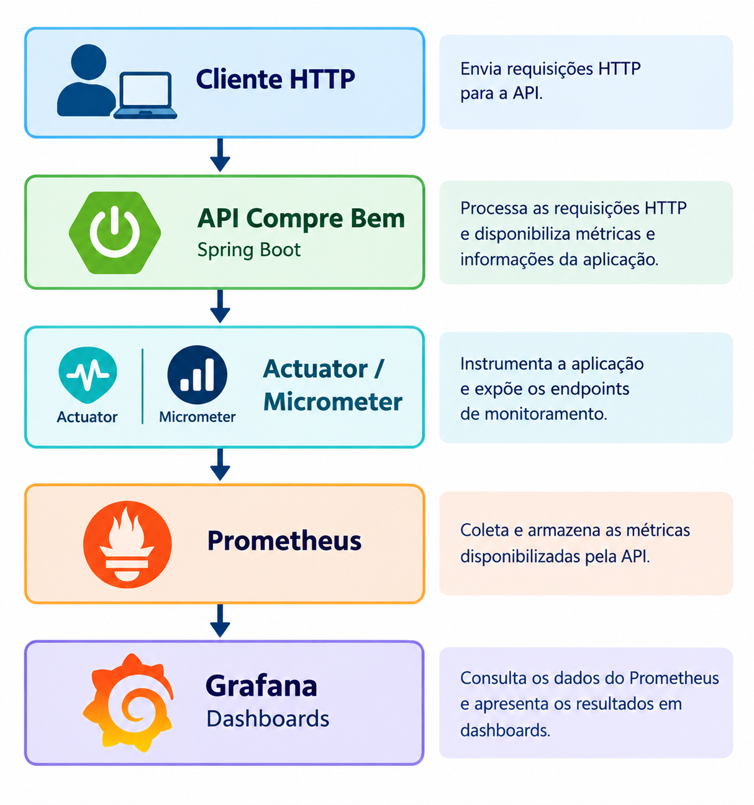
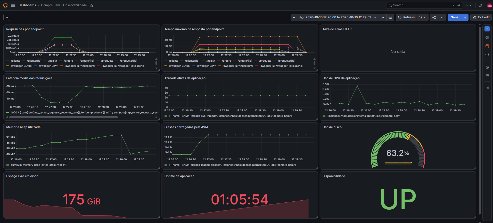
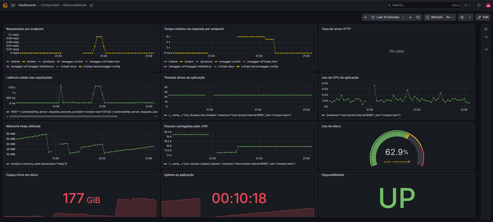
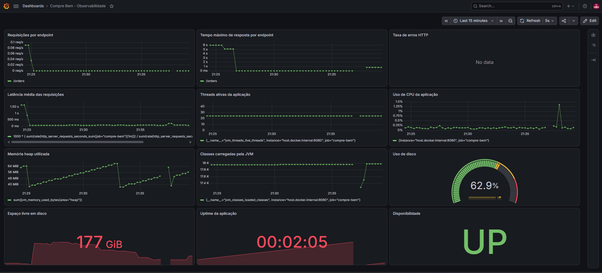
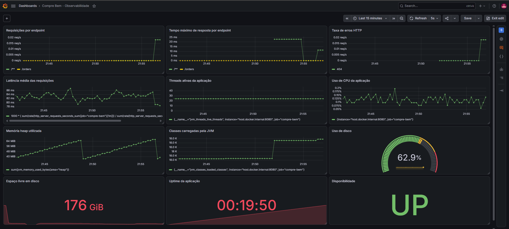
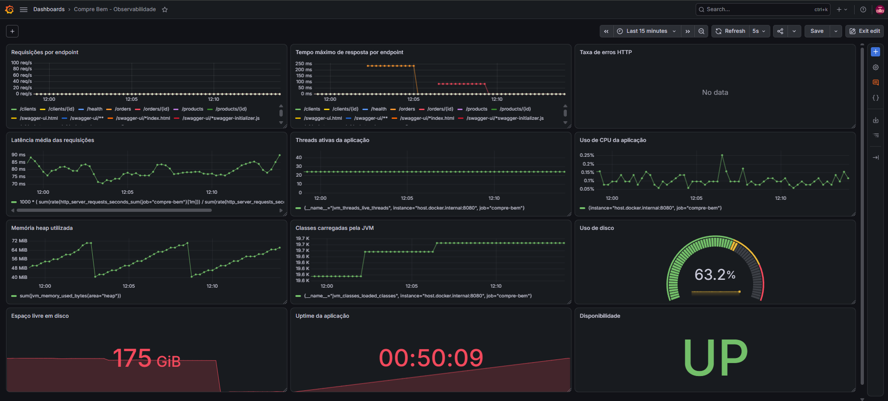
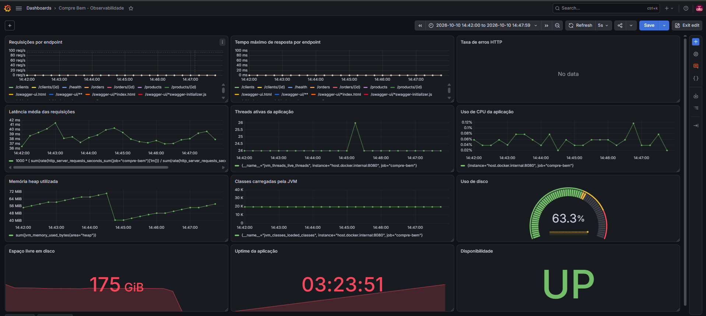
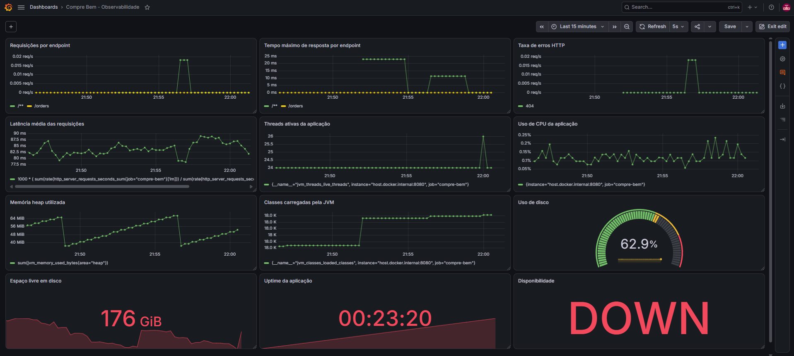
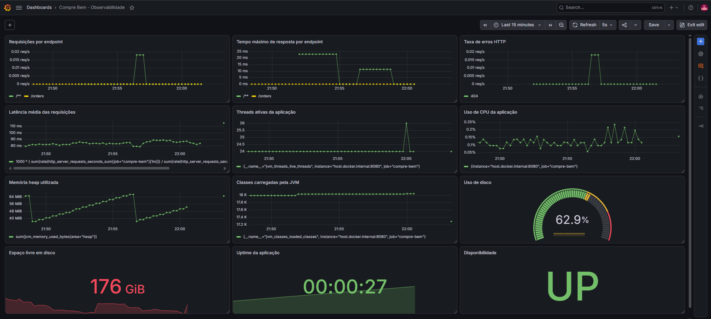

# Compre Bem — API com Observabilidade

## Sobre o projeto

O **Compre Bem** é uma aplicação web desenvolvida com Java e Spring Boot, integrada a um banco de dados PostgreSQL. O projeto utiliza ferramentas de observabilidade para acompanhar o comportamento da API, analisar o desempenho das requisições HTTP e identificar possíveis problemas durante a execução.

A solução utiliza **Prometheus** para coletar e armazenar métricas e **Grafana** para criar dashboards e visualizar os indicadores monitorados.

Este projeto também foi utilizado em um experimento prático para analisar os efeitos de uma degradação artificial de latência e verificar como as alterações no comportamento da API são refletidas nos indicadores de monitoramento.

**Projeto:** Compre Bem  
**Tema:** Monitoramento e observabilidade de uma API REST utilizando Prometheus e Grafana.

## Tecnologias utilizadas

- **Java 17:** linguagem de programação da aplicação.
- **Spring Boot:** framework para desenvolvimento da API REST.
- **Spring Boot Actuator:** disponibilização de informações operacionais e endpoints de monitoramento.
- **Micrometer:** instrumentação e exposição de métricas da aplicação.
- **PostgreSQL 17:** sistema gerenciador de banco de dados relacional.
- **Docker:** execução dos serviços em contêineres.
- **Prometheus:** coleta e armazenamento de métricas.
- **Grafana:** criação de dashboards para visualização e análise dos indicadores.

## Arquitetura

A arquitetura de monitoramento utiliza os seguintes componentes:

1. **Cliente HTTP:** envia requisições para a API.
2. **API Compre Bem (Spring Boot):** processa as requisições e disponibiliza métricas da aplicação.
3. **Spring Boot Actuator e Micrometer:** expõem endpoints e instrumentam a aplicação para a coleta de métricas.
4. **Prometheus:** coleta e armazena as métricas disponibilizadas pela API.
5. **Grafana:** consulta os dados do Prometheus e apresenta os resultados em dashboards.

### Fluxo de monitoramento



## Pré-requisitos

Antes de executar o projeto, verifique se os seguintes componentes estão instalados:

- Java Development Kit (JDK) 17.
- Docker Desktop.
- Git, caso o projeto seja obtido por meio de um repositório Git.
- Maven, caso não seja utilizado o Maven Wrapper incluído no projeto.


## Métricas monitoradas

Os dashboards do Grafana acompanham diferentes aspectos do comportamento da API.

| Indicador | Descrição |
|---|---|
| Latência média HTTP | Tempo médio de resposta das requisições no intervalo consultado. |
| Latência máxima HTTP | Maior tempo de resposta observado no intervalo consultado. |
| Taxa de requisições | Quantidade de requisições processadas por segundo. |
| Taxa de erros HTTP 4xx e 5xx | Proporção ou taxa de respostas de erro do cliente e do servidor, conforme a consulta configurada. |
| Disponibilidade do alvo (`up`) | Indica se o Prometheus consegue coletar métricas do alvo monitorado. |
| Uso de CPU | Consumo de processador conforme as métricas disponíveis. |
| Heap da JVM | Memória heap utilizada pela máquina virtual Java. |
| Threads ativas | Quantidade de threads ativas na aplicação. |
| Classes carregadas | Informações sobre classes carregadas pela JVM. |
| Espaço em disco | Indicadores de espaço em disco disponibilizados no ambiente. |
| Tempo de atividade | Tempo de execução da aplicação desde a inicialização. |

A métrica `up` indica o sucesso da coleta de métricas pelo Prometheus. Isoladamente, ela não garante que todos os endpoints da API estejam funcionando corretamente.

## Experimento de observabilidade

O experimento foi realizado em ambiente local, utilizando requisições HTTP e dashboards do Grafana para observar o comportamento da API em diferentes condições.

### Cenário de referência

Foram realizadas 45 requisições GET distribuídas entre nove endpoints. Nesse conjunto, a latência média registrada foi de aproximadamente **41,02 ms**, e todas as respostas apresentaram status HTTP 200.



### Degradação artificial de latência

Foi introduzido um atraso artificial no endpoint `/orders` para simular uma degradação de desempenho.

Nas cinco requisições realizadas durante essa condição, a latência média foi de aproximadamente **5.100,99 ms**. Todas as respostas permaneceram com status HTTP 200, demonstrando que uma requisição pode ser concluída com sucesso mesmo apresentando tempo de resposta elevado.



### Após a remoção do atraso

Após remover o atraso artificial e reiniciar a aplicação, foram realizadas mais cinco requisições ao endpoint `/orders`. A média observada foi de aproximadamente **223,70 ms**, influenciada pela primeira requisição, que apresentou maior latência.

As quatro requisições seguintes apresentaram tempos entre aproximadamente **74,28 ms e 80,25 ms**.



### Respostas HTTP 404

Também foi verificado o comportamento de uma requisição para uma rota inexistente. A resposta HTTP 404 foi registrada nas métricas e pôde ser analisada no Grafana.



Os resultados demonstram como a visualização das métricas auxilia na identificação de alterações na latência e de respostas HTTP de erro.

## Dashboards adicionais

As imagens abaixo registram outros estados e visualizações do ambiente de monitoramento durante os testes.

### Dashboard inicial de referência



### Dashboard de disponibilidade



### Teste de indisponibilidade do alvo

A imagem registra um momento em que o painel de disponibilidade apresenta o estado `DOWN`. Esse estado indica que o Prometheus não conseguiu coletar métricas do alvo naquele momento; não representa, por si só, uma verificação de todos os endpoints da API.



### Recuperação da coleta de métricas



## Consultas PromQL

O Prometheus utiliza a linguagem PromQL para consultar as métricas coletadas.

**Disponibilidade do alvo:**

```promql
up{job="compre-bem"}
```

**Contagem de requisições HTTP:**

```promql
http_server_requests_seconds_count
```

**Contagem de respostas HTTP 404, caso esse rótulo esteja disponível:**

```promql
http_server_requests_seconds_count{status="404"}
```

**Contagem de respostas HTTP 5xx, caso existam amostras correspondentes:**

```promql
http_server_requests_seconds_count{status=~"5.."}
```

A disponibilidade de cada consulta depende dos nomes das métricas, dos rótulos e da configuração efetivamente utilizada no ambiente.


Métricas de monitoramento, isoladamente, não fornecem todas as informações necessárias para diagnosticar qualquer problema. A análise pode ser complementada com logs centralizados, rastreamento distribuído e testes com cargas maiores.

## Referências e documentação

- [Spring Boot Actuator](https://docs.spring.io/spring-boot/reference/actuator/index.html)
- [Micrometer Documentation](https://docs.micrometer.io/)
- [Prometheus Documentation](https://prometheus.io/docs/introduction/overview/)
- [Grafana Documentation](https://grafana.com/docs/)
- [Docker Documentation](https://docs.docker.com/)
